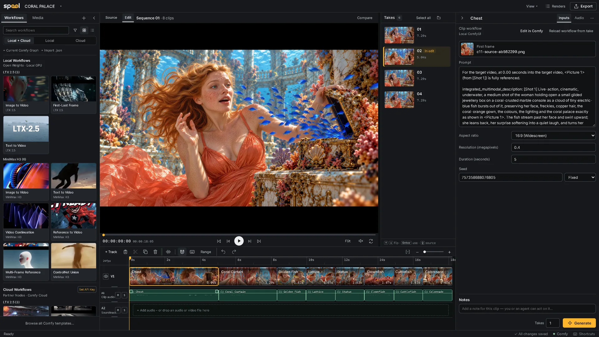

<h1 align="center">
  <picture>
    <source media="(prefers-color-scheme: dark)" srcset="docs/images/spool-logo-dark.svg">
    
  </picture>
</h1>

<p align="center"><b>A video timeline studio inside ComfyUI</b></p>

<p align="center">
  <a href="docs/guide/README.md"></a>
  <a href="CHANGELOG.md"></a>
  <a href="https://github.com/sponsors/doubletwisted"></a>
  <a href="https://buymeacoffee.com/doubletwisted"></a>
</p>

<p align="center">
  <a href="https://youtu.be/Z5H-dzL2kUU"></a>
</p>

Spool turns ComfyUI into a place to make a film, not just a shot. Lay out shots
on a timeline, generate takes for each one with your own workflows, compare
them, and choose the take that goes in the edit. Takes render on this computer,
on Comfy Cloud or on a Deadline farm.

Your workflows stay as they are: Spool needs no custom nodes in the graph.



> [!NOTE]
> Spool 0.1.0 is an early release, tested on Windows and Apple Silicon macOS.
> macOS support remains experimental while Desktop and downloaded-launcher checks
> are completed; Linux is untested. Expect rough edges, and please [report them](https://github.com/doubletwisted/ComfyUI-Spool/issues/new?template=bug_report.yml).

## Requirements

- ComfyUI 0.39.0 or newer (tested with 0.43.1 / frontend 1.57.4 on Windows,
  and 0.43.0 / frontend 1.57.4 on Apple Silicon)
- Python 3.11 or newer
- `ffmpeg` and `ffprobe` on the PATH of the process running ComfyUI (on macOS,
  Spool also finds a Homebrew or MacPorts install)
- For Comfy Cloud: a Comfy API key

If something is missing, the studio shows **Setup needed** in its top bar and
ComfyUI's startup log says what to install.

## Install

**ComfyUI Manager:** search for **Spool** and install `spool-timeline`. With
comfy-cli: `comfy node install spool-timeline`.

**Manually:** clone into `custom_nodes` and install the requirements with the
Python that runs ComfyUI:

```powershell
cd ComfyUI/custom_nodes
git clone https://github.com/doubletwisted/ComfyUI-Spool Spool
python -m pip install -r Spool/requirements.txt
```

On the Windows portable build, use `python_embeded\python.exe` instead of
`python`; with ComfyUI Desktop on macOS, use `.venv/bin/python` in its ComfyUI
folder. Restart ComfyUI and reload the browser tab.

## Quick start

1. Click **Open Spool ↗** in ComfyUI's top bar, then **New project**.
2. Open **Workflows** and click a card to add a shot. You can also drag a ComfyUI
   workflow tab or a `.json` file onto the timeline, or import footage under
   **Media**.
3. Select the clip and fill in its inputs on the right: source, prompt, duration,
   seed.
4. Set the number of **Takes** and click **Generate**.
5. Review the takes, compare two side by side, and click **Use take**.
6. Trim and arrange the clips, add a soundtrack and **Export**.

## Documentation

- [Editing](docs/guide/editing.md): the timeline, audio, takes, media and export,
  including OpenTimelineIO for Resolve and Premiere Pro
- [Generation](docs/guide/generation.md): workflows, clip inputs, Edit in Comfy,
  Renders and Comfy Cloud
- [Projects and storage](docs/guide/projects.md): project folders, saving and
  running without ComfyUI
- [Agents and automation](docs/guide/automation.md): the scoped command API, the
  CLI and the [`spool-control` skill](skills/spool-control/SKILL.md)
- [Deadline](docs/guide/deadline.md): rendering takes on a Thinkbox Deadline farm
  (experimental)
- [Security and network access](docs/guide/security.md)

## FAQ

<details>
<summary>Do my workflows need Spool nodes?</summary>

No. Spool reads an ordinary workflow, exposes its main inputs on the clip and
leaves the graph alone. **Edit in Comfy** opens the clip's workflow in a ComfyUI
tab, and **Apply to clip** brings your changes back.
</details>

<details>
<summary>Will a new render replace the take in my edit?</summary>

No. New results are added as takes. Only **Use take** changes what plays in the
edit.
</details>

<details>
<summary>Do I need a GPU?</summary>

Not for Comfy Cloud: Cloud renders need neither a local GPU nor a running
ComfyUI. Local renders use the GPU of the ComfyUI that Spool runs in.
</details>

<details>
<summary>Can I use Comfy Cloud with a free account?</summary>

Running on Comfy Cloud needs a plan that allows API keys. With a free account,
set **Execute on** to **Local ComfyUI · Partner Nodes**: the workflow runs on your
ComfyUI and pays for Partner Nodes with Comfy credits. See
[Comfy Cloud](docs/guide/generation.md#comfy-cloud).
</details>

<details>
<summary>Where is my work saved?</summary>

Each project is a folder holding `project.spool`, the inputs you add and one
folder of takes per clip. Open it from another computer or a network share to
continue. Spool's own settings live in `ComfyUI/user/spool`; the Comfy Cloud key
is stored outside every project. See [Projects and storage](docs/guide/projects.md).
</details>

<details>
<summary>Can I edit while ComfyUI is stopped?</summary>

Yes. Double-click `run_spool.bat` (Windows) or `run_spool.command` (macOS) in
the Spool folder, or run `python -m spool --open` there. Editing, import and export work without ComfyUI,
and Spool can start your ComfyUI for you. See
[Running without ComfyUI](docs/guide/projects.md#running-without-comfyui).
</details>

<details>
<summary>Which workflows does Spool understand?</summary>

Spool stages files for LoadImage, LoadImageMask, LoadAudio, LoadVideo and
VHS_LoadVideo, and collects results from SaveImage, PreviewImage, SaveVideo and
VHS_VideoCombine. Inputs it cannot identify with confidence stay in the
workflow's saved settings, editable through **Edit in Comfy**. See
[Limitations](docs/guide/generation.md#limitations).
</details>

<details>
<summary>Does it work on macOS or Linux?</summary>

Experimentally. The Apple Silicon source install has passed real CPU generation,
collection, media import/export, browser and standalone-launcher checks on an
M3 Max running macOS 27.0.1. This does not verify Apple GPU/model performance,
Intel Macs or Linux. See the [Mac test results](https://github.com/doubletwisted/ComfyUI-Spool/pull/18)
and the remaining [Desktop and downloaded-launcher checks](https://github.com/doubletwisted/ComfyUI-Spool/issues/17).
Use Chrome for the studio; Safari has only had a basic playback check.
**Reveal in Finder** and **Open clip folder** use Finder on macOS and `xdg-open`
on Linux, and the studio shows Cmd and Option in its shortcuts on a Mac. Deadline
farms that mix macOS and Windows machines are not supported. Please
[report what you find](https://github.com/doubletwisted/ComfyUI-Spool/issues/new?template=bug_report.yml).
</details>

<details>
<summary>Is it safe to run ComfyUI with <code>--listen</code>?</summary>

Only on a network you trust. Spool has no user accounts, so anyone who can reach
ComfyUI's port can open and change projects and queue renders on your key. See
[Security and network access](docs/guide/security.md).
</details>

## Support

If Spool saves you time, you can support its development through
[GitHub Sponsors](https://github.com/sponsors/doubletwisted) or
[Buy Me a Coffee](https://buymeacoffee.com/doubletwisted).

Found a bug or want a feature? Open an
[issue](https://github.com/doubletwisted/ComfyUI-Spool/issues/new/choose). Want to
help? Read [CONTRIBUTING.md](CONTRIBUTING.md).

## License

GPL-3.0. See [LICENSE](LICENSE) and [THIRD_PARTY_NOTICES.md](THIRD_PARTY_NOTICES.md).
